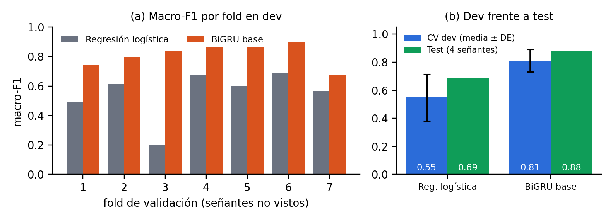

# Reconocimiento de señas aisladas de la Lengua de Señas Colombiana (LSC-54)

**Una red recurrente sobre landmarks de MediaPipe frente a una línea base clásica, evaluadas con señantes no vistos**


Proyecto integrador de **Técnicas Avanzadas de Modelado**, Maestría en Analítica Aplicada e Inteligencia Artificial, Universidad de La Sabana (2026-II).
**Equipo (Grupo 8):** Andrés Díaz · Lorena Valero · Jorge Anaya · Sabrina Miranda

> **Estado: proyecto finalizado.** Las tres entregas, la ficha del modelo y todas las cifras reportadas están versionadas en este repositorio y pueden regenerarse con los scripts que se describen abajo.

---

## Contenido

1. [Resumen](#1-resumen)
2. [Resultados principales](#2-resultados-principales)
3. [Entregables](#3-entregables)
4. [Datos y partición](#4-datos-y-partición)
5. [Método](#5-método)
6. [Reproducción paso a paso](#6-reproducción-paso-a-paso)
7. [Pesos del modelo entrenado](#7-pesos-del-modelo-entrenado)
8. [Trazabilidad, semillas y control de fuga](#8-trazabilidad-semillas-y-control-de-fuga)
9. [Estructura del repositorio](#9-estructura-del-repositorio)
10. [Correspondencia con los criterios de evaluación](#10-correspondencia-con-los-criterios-de-evaluación)
11. [Limitaciones y uso responsable](#11-limitaciones-y-uso-responsable)
12. [Equipo, forma de trabajo y uso de IA](#12-equipo-forma-de-trabajo-y-uso-de-ia)
13. [Datos, licencia y cómo citar](#13-datos-licencia-y-cómo-citar)

---

## 1. Resumen

Se clasifican **43 señas aisladas** de la LSC (33 expresiones de cortesía y los números del uno al diez) a partir de los landmarks de manos y torso que MediaPipe extrae de cada video. El uso previsto es una herramienta de práctica: un estudiante hace la seña frente a la cámara y el sistema le indica si corresponde a la solicitada. Como el sistema siempre se enfrentará a una persona nueva, **toda la evaluación se hace sobre señantes que no participaron en el entrenamiento**.

**Pregunta experimental.** Bajo una partición independiente del señante, ¿un modelo secuencial sobre landmarks mejora el macro-F1 frente a una línea base clásica sobre estadísticas de los landmarks, y a qué costo computacional?

**Respuesta.** Sí. La BiGRU con atención temporal supera a la regresión logística en los 7 folds de validación cruzada y en el test bloqueado, con un costo de entrenamiento mayor, pero con una latencia compatible con el uso interactivo. La ganancia depende de la persona y de la calidad de detección, y el modelo es sobreconfiado, por lo que debe recalibrarse antes de cualquier uso.

## 2. Resultados principales

| | Regresión logística (línea base) | **BiGRU base** |
|---|---|---|
| Macro-F1, validación cruzada por señante (7 folds) | 0,548 ± 0,166 | **0,811 ± 0,079** |
| Folds en que gana la BiGRU | — | **7 de 7** |
| Diferencia agrupada, IC 95 % por remuestreo de señantes | — | **+0,244 [+0,16; +0,37]** |
| Macro-F1, test bloqueado (4 señantes, una sola evaluación) | 0,685 | **0,881** |
| Exactitud / top-3 en test | 0,669 / 0,829 | **0,869 / 0,955** |
| Parámetros | 21.242 | 552.023 |
| Tiempo de ajuste (desarrollo completo, CPU) | 0,9 s | 227 s |
| Latencia por video (individual, CPU) | — | 6,8 ms |

- **Regla de decisión fijada antes de ver resultados:** mejora de macro-F1 de al menos 0,05 y en al menos 5 de 7 folds. Se cumple con amplitud.
- **La línea base no explica la brecha por falta de ajuste:** con otros valores de C, un bosque aleatorio y una SVM sobre las mismas 493 variables, la mejor opción llega a 0,554 ([`baseline_sensibilidad_cv.json`](reports/e3_final/baseline_sensibilidad_cv.json)).
- **14 experimentos de un factor a la vez:** la aumentación, la máscara de detección y la duración aportan; ninguna variante supera a la base de forma distinguible del ruido; la Conv1D empata, lo que indica que la ganancia proviene de modelar la secuencia ([`tabla_experimentos.csv`](reports/e2_avance/tabla_experimentos.csv)).
- **Variación entre personas:** de 0,69 a 0,92 de macro-F1 en test. Los errores se concentran en números contiguos (seis → uno).
- **Calibración:** ECE de 0,114, con una confianza media de 0,925 frente a una exactitud de 0,812 ([`cifras_informe.json`](reports/e3_final/cifras_informe.json)).

<p align="center">
  
</p>

## 3. Entregables

| Entrega | Documento | Contenido |
|---|---|---|
| 1. Plan experimental | [`plan_experimental.pdf`](reports/e1_plan/plan_experimental.pdf) | Problema, datos y licencia, auditoría, partición, línea base y plan de experimentos |
| 2. Reporte técnico de avance | [`informe_avance.pdf`](reports/e2_avance/informe_avance.pdf) | Red avanzada, experimentos controlados, curvas, comparación y errores |
| 3. Informe final | [`informe_final.pdf`](reports/e3_final/informe_final.pdf) | Ciclo completo, test bloqueado, calibración, riesgos y recomendaciones |
| Ficha del modelo y de los datos | [`MODEL_CARD.md`](MODEL_CARD.md) | *Model card* y *datasheet* resumida |
| Decisión previa al test | [`DECISION.md`](reports/e3_final/DECISION.md) | Modelo y justificación registrados antes de abrir el test |
| Protocolo de experimentos | [`EXPERIMENTOS.md`](reports/e2_avance/EXPERIMENTOS.md) | Pregunta y factor de cada experimento |
| Presentación | [`presentacion.pdf`](reports/e3_final/presentacion.pdf) | 17 diapositivas y anexo de referencias |
| Video de sustentación | [YouTube](https://youtu.be/7xBtHQd6UCg) | Defensa oral del equipo, con recorrido por este repositorio |

## 4. Datos y partición

- **Fuente:** LSC-54 (Mora-Zarate et al., 2025). Se usa la campaña S2: **1.740 videos únicos, 43 clases y 18 señantes**. Se excluye la campaña de colores (S1) porque su numeración de señantes es independiente y no permite garantizar que una persona no quede a ambos lados de la partición. No se usa la versión aumentada ×45, porque multiplicar videos antes de particionar es una fuente de fuga.
- **Auditoría:** 113.658 cuadros procesados; pose detectada en el 99,5 % de los cuadros y la mano más activa en el 60 %; detección por señante de 0,46 a 0,97 ([`landmarks_audit.csv`](data/inventory/landmarks_audit.csv)).
- **Partición v1, fijada antes de modelar** ([`split_v1.csv`](splits/split_v1.csv)):

| Partición | Señantes | Videos | Uso |
|---|---|---|---|
| Desarrollo | 14 | 1.359 | Validación cruzada agrupada en 7 folds; cada fold valida con 1 señante que graba las 43 clases y 1 que graba 21 |
| Test bloqueado | 4 (S2-01, S2-03, S2-29, S2-31) | 381 | Una sola evaluación final |

## 5. Método

```
Video → MediaPipe Holistic (98 coordenadas por cuadro) → píxeles, centrado y escala de hombros
      ├─ Línea base: 493 estadísticas por video → imputación y estandarización → regresión logística
      └─ BiGRU: 32 cuadros, interpolación y máscara → proyección 128 → BiGRU 2×128 → atención → 43 clases
```

- **Línea base:** media, desviación, mínimo, máximo y velocidad de cada coordenada, más detección y duración; regresión logística multinomial (C = 1).
- **Modelo avanzado:** GRU bidireccional de 2 capas con atención temporal y 552.023 parámetros; AdamW (tasa 1e-3, weight decay 0,01), 80 épocas fijas con calentamiento y coseno, recorte del gradiente en 1,0 y aumentos solo en entrenamiento. Se reporta la última época, sin parada temprana. La configuración completa está en [`configs/model.yaml`](configs/model.yaml).

## 6. Reproducción paso a paso

**Requisitos:** Python 3.11 o 3.12 (MediaPipe 0.10.21 no funciona con 3.13), unos 2 GB libres y CPU. No se necesita GPU. Probado en macOS (Apple Silicon), Windows y Linux.

```bash
# 1. Entorno
git clone https://github.com/andresdila/lsc54-reconocimiento-senas.git
cd lsc54-reconocimiento-senas
conda create -n lsc54 python=3.11 -y
conda activate lsc54
pip install -r requirements.lock

# 2. Datos: descarga (~0,97 GB) desde la fuente oficial, verifica MD5 y genera el inventario
python scripts/download_data.py
python scripts/make_split.py --check-only

# 3. Landmarks de MediaPipe (1.740 videos; ~45 min con 2 procesos)
python scripts/extract_landmarks.py --workers 2

# 4. Pruebas automáticas, incluidos los controles contra la fuga de información
pytest -q

# 5. Línea base en validación cruzada por señante
python scripts/train_baseline.py --model dummy_majority
python scripts/train_baseline.py --model logreg

# 6. BiGRU base y experimentos de un factor a la vez (~35 min por experimento en CPU)
python scripts/train_sequence.py --name base
python scripts/run_experiments.py
python scripts/compare_models.py --candidate base

# 7. Análisis de la Entrega 3: sensibilidad de la línea base y cifras de calibración y errores
python scripts/tune_baseline.py
python scripts/report_numbers.py

# 8. Pesos del modelo final (sin tocar el test; ~4 min en CPU con 8 hilos)
python scripts/export_model.py
```

| Paso | Salida principal |
|---|---|
| 2 | `data/inventory/lsc54_v4_inventory.csv` y su auditoría |
| 3 | `data/processed/landmarks/*.npy` (no versionado) y `data/inventory/landmarks_audit.csv` |
| 5 | `reports/e1_plan/baseline_*_cv.json` |
| 6 | `reports/e2_avance/runs/<experimento>/` y `reports/e2_avance/tabla_experimentos.csv` |
| 7 | `reports/e3_final/baseline_sensibilidad_cv.json` y `reports/e3_final/cifras_informe.json` |
| 8 | `outputs/bigru_base_final.pt` y su `.sha256` |

`requirements.txt` declara los rangos compatibles y `requirements.lock` fija las versiones exactas con que se verificó la reproducción.

**Test bloqueado.** No forma parte de la secuencia anterior. Se evaluó una única vez, con el commit `9431af2` y el árbol limpio, mediante `train_baseline.py --model logreg --final-test` y `train_sequence.py --name base --final-test`. Ambos scripts se niegan a repetirlo, y sus resultados están en `reports/e1_plan/baseline_logreg_test.json` y `reports/e3_final/sequence_base_test.json`.

**Seguimiento de experimentos.** Cada corrida queda en MLflow (backend SQLite) además de los JSON y CSV versionados:

```bash
mlflow ui --backend-store-uri sqlite:///mlflow.db
```

## 7. Pesos del modelo entrenado

Los pesos no se versionan en Git por su tamaño. Están publicados como adjunto de la versión [**v3-final**](https://github.com/andresdila/lsc54-reconocimiento-senas/releases/tag/v3-final) (`bigru_base_final.pt`, con su suma SHA-256) y pueden regenerarse con `python scripts/export_model.py`, que entrena la configuración base con los 14 señantes de desarrollo y la misma semilla, sin cargar el test.

```python
import sys, torch
sys.path.insert(0, "src"); sys.path.insert(0, "scripts")
from train_sequence import build_model

ckpt = torch.load("outputs/bigru_base_final.pt", weights_only=False)
model = build_model(ckpt["config"], len(ckpt["classes"]))
model.load_state_dict(ckpt["state_dict"])
model.eval()
```

El archivo incluye, además de los pesos, el estandarizador ajustado, la lista de clases, la configuración, la semilla y las versiones de las librerías. El entrenamiento en CPU no es bit a bit idéntico entre máquinas: en otra máquina la BiGRU base dio 0,808 ± 0,079 frente a 0,811 ± 0,079 en validación cruzada.

## 8. Trazabilidad, semillas y control de fuga

- **Semilla:** 2026 para la partición y, en cada fold, 2026 más el número de fold ([`configs/split.yaml`](configs/split.yaml)).
- **Metadatos en cada resultado:** cada JSON registra la semilla, la versión de la partición, el hash del commit, si el árbol estaba limpio y las versiones de Python, PyTorch, scikit-learn y NumPy.
- **Decisiones registradas antes de ver resultados:** la regla de decisión y la candidata, en el plan; el modelo para el test, en `DECISION.md` (commit `dbbe611`).
- **Controles contra la fuga:**
  - partición por señante, nunca por video;
  - pruebas automáticas que verifican que ningún señante aparezca en dos particiones, incluida una que planta una fuga y comprueba que se detecta;
  - imputación y estandarización ajustadas dentro de cada fold;
  - selección de hiperparámetros solo con desarrollo;
  - test evaluado una única vez.
- **Equivalencia de commits:** los mensajes se reescribieron antes de publicar las ramas, por lo que `bbbc4a4` y `dbbe611` corresponden al mismo árbol de archivos.

## 9. Estructura del repositorio

```
├── configs/            Decisiones experimentales en YAML (datos, partición, modelo)
├── data/inventory/     Inventario y auditoría de calidad (los videos y landmarks no se versionan)
├── splits/             Partición v1 por señante (versionada)
├── src/lsc/            Paquete reutilizable
│   ├── data/           Inventario, tabla de trabajo y partición
│   ├── features/       Estadísticas por video y representación secuencial
│   ├── models/         BiGRU, LSTM y Conv1D con atención temporal
│   └── eval/           Métricas
├── scripts/            Puntos de entrada (descarga, extracción, entrenamiento, comparación)
├── tests/              Pruebas automáticas, incluidos los controles contra la fuga
├── reports/
│   ├── e1_plan/        Entrega 1: informe y resultados de la línea base
│   ├── e2_avance/      Entrega 2: informe, corridas, figuras y tabla de experimentos
│   └── e3_final/       Entrega 3: informe, presentación, decisión previa, test y análisis finales
├── notebooks/          Exploración
├── MODEL_CARD.md       Ficha del modelo y de los datos
├── requirements.txt    Dependencias con rangos compatibles
└── requirements.lock   Versiones exactas verificadas
```

## 10. Correspondencia con los criterios de evaluación

| Criterio | Evidencia en el repositorio |
|---|---|
| Problema, datos, licencia y auditoría | Entrega 1, secciones 1 a 3; `data/inventory/`; sección 4 de este README |
| Partición justificada y control de fuga | `splits/`, `tests/test_split.py`, `make_split.py --check-only` |
| Línea base reproducible | `scripts/train_baseline.py`, `reports/e1_plan/`, análisis de sensibilidad en `reports/e3_final/` |
| Red avanzada justificada capa a capa | `src/lsc/models/sequence.py`, Entrega 2 (Tabla 3) |
| Experimentos controlados y registro | `scripts/run_experiments.py`, `reports/e2_avance/runs/`, MLflow |
| Curvas, comparación y análisis de errores | Entregas 2 y 3; `reports/e2_avance/figures/` |
| Test reservado para la evaluación final | `DECISION.md`, `reports/e3_final/sequence_base_test.json` |
| Eficiencia computacional | Tiempos de ajuste y latencia en los JSON de resultados y en la sección 2 |
| Reproducibilidad: semillas, dependencias y pesos | Secciones 6 a 8; `requirements.lock`; versión `v3-final` |
| Ficha del modelo y de los datos, riesgos y limitaciones | `MODEL_CARD.md`; Entrega 3, sección 9 |
| Presentación y defensa oral | `reports/e3_final/presentacion.pdf`; video de sustentación (sección 3) |

## 11. Limitaciones y uso responsable

- **Uso previsto:** apoyo a la práctica de vocabulario básico de LSC, mostrando las tres señas más probables y no una sola respuesta.
- **Usos no previstos:** traducción, sustitución de intérpretes, evaluación o calificación de personas, reconocimiento de lengua continua, vigilancia o uso comercial.
- **Limitaciones:**
  - 18 señantes sin metadatos demográficos y solo 4 en test, con un test algo optimista por su mejor detección de manos;
  - 43 señas aisladas de una sola campaña;
  - sobreconfianza (ECE de 0,114);
  - dependencia de la calidad de detección de MediaPipe.
- **Antes de cualquier uso real:** validación con la comunidad sorda y con docentes de LSC, más datos de más personas, recalibración de las probabilidades y un umbral de confianza para abstenerse.

El detalle está en [`MODEL_CARD.md`](MODEL_CARD.md) y en la sección 9 del informe final.

## 12. Equipo, forma de trabajo y uso de IA

**Equipo:** Andrés Díaz, Lorena Valero, Jorge Anaya y Sabrina Miranda.

**Forma de trabajo:** nadie sube cambios directamente a `main`. Cada integrante trabaja en su rama (`nombre/tarea`), abre un Pull Request y otra persona del equipo lo revisa antes de unirlo.

**Uso de inteligencia artificial:** se utilizó un asistente de IA generativa como apoyo en la construcción conjunta y la optimización del código, con el propósito de asegurar la reproducibilidad del flujo. Las decisiones experimentales, el análisis de los resultados y las conclusiones son del equipo y no fueron alteradas ni ajustadas por la herramienta.

## 13. Datos, licencia y cómo citar

**Datos:** LSC-54 (Mora-Zarate, Garzón-Castro y Castellanos-Rivillas, 2025, *Data in Brief*, 63, 112145), Science Data Bank, DOI [10.57760/sciencedb.25639](https://doi.org/10.57760/sciencedb.25639), licencia **CC BY-NC 4.0**. Uso académico y no comercial, con atribución. Los videos no se redistribuyen en este repositorio: `scripts/download_data.py` los obtiene de la fuente oficial.

**Cómo citar este trabajo:**

> Díaz, A., Valero, L., Anaya, J. y Miranda, S. (2026). *Reconocimiento de señas aisladas de la Lengua de Señas Colombiana: una red recurrente sobre landmarks frente a una línea base clásica*. Proyecto integrador, Técnicas Avanzadas de Modelado, Universidad de La Sabana. https://github.com/andresdila/lsc54-reconocimiento-senas

**Referencias principales:**
- Mora-Zarate et al. (2025), LSC-54.
- Lugaresi et al. (2019), MediaPipe.
- Cho et al. (2014), GRU.
- Loshchilov y Hutter (2019), AdamW.
- Mitchell et al. (2019), *Model Cards*.
- Gebru et al. (2021), *Datasheets for Datasets*.
- NIST (2023), *AI RMF 1.0*.
